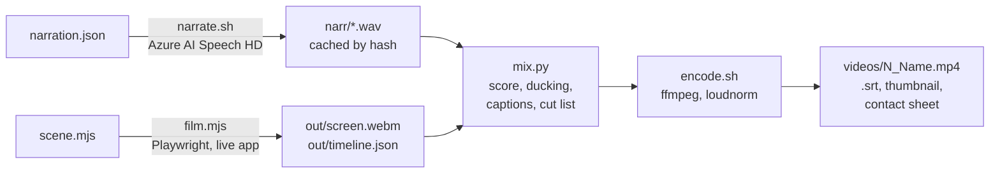

# Demo Video Production: How the AADB Video Series Is Made

This guide explains how the Azure Architecture Diagram Builder (AADB) demo videos are produced, and records the lessons learned from the first nine episodes. It is written to be reused: the same approach works for any web app that you want to demo with repeatable, narrated, captioned videos.

- **Status:** episodes 1–9 recorded on the production app (October 2026); episodes 10–12 planned.
- **Toolkit:** [`demo-videos/`](../demo-videos/README.md) in this repository: the film engine (Playwright + Azure AI Speech + Python + ffmpeg), all nine episode scripts, and a short example episode to start from.

## Contents

1. [The approach in one paragraph](#the-approach-in-one-paragraph)
2. [Pipeline](#pipeline)
3. [Anatomy of an episode](#anatomy-of-an-episode)
4. [The film engine API](#the-film-engine-api)
5. [Making an episode, step by step](#making-an-episode-step-by-step)
6. [Lessons learned](#lessons-learned)
7. [Reusing this for another project](#reusing-this-for-another-project)
8. [Episode log](#episode-log)

## The approach in one paragraph

Every video is **recorded live on the real production app** by a Playwright script (the *scene*), not edited by hand. The scene clicks through the product while the engine records the screen and a **timeline** of events: when each narration line starts, which waits should be sped up, and where the visual "reveals" are. Narration is synthesized separately with an Azure AI Speech HD voice. A post-processing step then builds the soundtrack (narration plus an original synthesized score that ducks under the voice), burns in subtitles, writes an `.srt` sidecar, speeds up the waits, and encodes a 1080p MP4 at −16 LUFS. Because the whole video is code, a retake is a single command, and the video always shows the current version of the product.

## Pipeline



| Step | Tool | What it does |
| --- | --- | --- |
| `narrate.sh` | Azure AI Speech REST (keyless, Entra token) | Turns each narration cue into a 24 kHz WAV. A cue is re-synthesized only when its text or the voice changes (hash stored next to the WAV). |
| `film.mjs` + `scene.mjs` | Playwright (Chromium, 1920×1080, `recordVideo`) | Drives the live app, injects an overlay layer (title cards, subtitles, tags, highlight rings, a drawn cursor) and writes `timeline.json`. |
| `mix.py` | NumPy / SciPy | Places narration at the recorded times, remaps every timestamp through the sped-up segments, renders and ducks the music, writes `captions.srt` and an ffmpeg filter (trim + speed + fades). |
| `music.py` | NumPy / SciPy | Original score synthesized in code (drums, bass, pads, piano), with presets `drive`, `lift`, `pulse` and `ambient`. A riser leads into each reveal, with a hit on the reveal. No samples, so no licensing. |
| `encode.sh` | ffmpeg | H.264 CRF 18 + AAC 192k, `loudnorm` to −16 LUFS, `.srt` copy, thumbnail at the first reveal, and a 12-frame contact sheet for review. |
| `run.sh` | bash | Runs all of the above. `STEP=mix` re-mixes and re-encodes without recording again (for example, after changing the music). |

## Anatomy of an episode

```text
episodes/08-deploy-it/
├── episode.json      # output name, badge, title, music preset, voice, internal flag
├── narration.json    # [["n01-open", "text or SSML"], ...]
├── storyboard.md     # shot list: what's on screen and which cue plays
├── scene.mjs         # the Playwright script
├── assets/           # fixed inputs (saved diagram, ARM template, seller voice clips, ...)
├── narr/             # synthesized cues (generated, git-ignored)
├── out/              # screen.webm, timeline.json, downloads/ (generated)
└── review/contact-sheet.png
```

`episode.json` example:

```json
{
  "output": "8_Deploy-It",
  "badge": "Episode 8",
  "title": "Deploy It",
  "music": "lift",
  "voice": "en-US-Andrew:DragonHDLatestNeural",
  "internal": false
}
```

Optional flags: `"voice_live": true` adds a fake microphone (voice episodes), `"media_tap": true` captures in-page WebRTC audio (the avatar presenter), `"url"` overrides the app URL, `"duck"` and `"musicLevel"` tune the mix.

Every episode follows the same shape: **cold open** (a one-line problem on an animated card) → **title card** → the product, live → **end card** with the short link. The end card states "recorded live on the production app", or flags internal/beta content when `internal` is true.

## The film engine API

A scene receives `f` and drives `f.page` (a Playwright page) with these helpers:

| Helper | Purpose |
| --- | --- |
| `f.say(cue, { wait, pad })` | Show the cue's subtitle and log its start in the timeline. With `wait: false` it returns a promise, so actions run *during* the line. |
| `f.ff(fn, { max })` | Run `fn`; if it takes more than 2 s, that stretch is sped up 6× in post, or faster so that it lasts at most `max` seconds on screen. |
| `f.reveal()` | Mark a reveal: the score adds a riser before it and a hit on it. |
| `f.card(html)` / `f.opener()` / `f.endCard()` | Full-screen cards (cold open, title, end). |
| `f.tag(text)` | A small label in the corner ("Writing the guide · sped up", "Saved · file.pptx"). |
| `f.ring(selector, label)` | A highlight ring with a callout under the element. |
| `f.cursor(on)`, `f.pointTo(target, { click })`, `f.drag(from, dx, dy)` | A visible cursor that glides to elements; clicks draw a ripple. |
| `f.subTop(on)` | Move subtitles to the top when a dialog's controls sit at the bottom. |
| `f.stage(html)`, `f.glide(...)` | A full-screen stage for images and slides, and eased scrolling. |
| `f.clip(wav, caption)`, `f.pcm(at, b64)`, `f.caption(...)` | Voice episodes: speak a clip into the fake microphone, lay captured audio on the soundtrack, and add caption lines. |
| `f.fit()` | Wait for the canvas layout to settle, then fit the view. |

A typical beat:

```js
const n4 = f.say('n04-generate', { wait: false, pad: 0.4 });   // narration starts
await f.pointTo('[data-v="gen"]', { click: true });              // the viewer sees the click
await f.tag('Writing the guide · sped up');
await f.ff(async () => {                                         // a 60 s model call → ~9 s on screen
  await page.locator('.deployment-modal .guide-header').waitFor({ timeout: 420000 });
}, { max: 9 });
await n4;                                                        // don't step on the line
f.reveal();
```

## Making an episode, step by step

1. **Storyboard first.** Write `storyboard.md` as a table: on-screen beat → narration cue. Keep each cue to one idea, and write the narration in `narration.json`.
2. **Probe off camera.** Before writing the scene, run a short headless Playwright probe that performs the episode's actions and saves screenshots and downloads. This shows the real selectors, timings and artifacts, and it is where most product bugs were found.
3. **Write the scene.** Start from the closest existing episode. Tag elements with `data-v` attributes so rings and clicks have stable targets.
4. **Synthesize narration.** Run `narrate.sh`, which also prints each cue's length; adjust the pacing to match.
5. **Record.** `engine/run.sh episodes/NN-name` (a take is 3–6 minutes; run it in the background). The log prints every cue and the live values read from the page.
6. **Review.** Look at `review/contact-sheet.png`, then pull frame strips around anything risky with ffmpeg (`-ss <t> -frames:v 1`). Don't call a take done from the log alone.
7. **Fix and retake.** Fix the scene, or fix the product (see below), and run the take again.
8. **Record what changed.** Note the episode's status, the product version it was recorded on and any findings in the series README.

## Lessons learned

### Record the real product, live

- **Live recording beats screen capture plus editing.** Retakes are cheap, every episode matches the current release, and the video is honest: what viewers see is what the product does today.
- **Shareable episodes use production only.** Beta features go in episodes flagged `internal: true`, and the end card says so.
- **Start every take from a saved asset.** A saved diagram (the "Clinic Booking · first draft") makes every take start identically. Reusing it across episodes 3, 5, 6, 8 and 9 also gives the series continuity.
- **Use fictional, generic inputs:** a Contoso ARM template, an AI-generated whiteboard photo and generic scenarios. No customer names.

### Write narration for live, varying output

- **Narration never quotes values the AI produces.** Scores, step counts, rankings and compiler results vary per run. The scene reads the real values from the page and shows them in callouts or summary cards, while the voice stays generic ("the guide opens with an overview…"). Deterministic values, such as region prices from fixed snapshots, can be quoted.
- **Write fallback lines for branches.** When the outcome changes the story, synthesize both lines and let the scene pick one. Examples: `n12-terminal` vs `n12-build-only` when `what-if` can't run, and a deck line with and without the Well-Architected slide. The voice must always match the screen.
- **Label sped-up waits "sped up".** Viewers should know that a model call took a minute, not three seconds.
- **Show real artifacts, rendered by the real tool.** The Bicep is built with `az bicep build` and checked with `az deployment group what-if`. The deck is opened and exported by PowerPoint, and the `.drawio` file is edited in diagrams.net. Each window is labelled "real run" or "real session".

### Overlay and Playwright techniques

- **Draw your own cursor.** Playwright recordings have no OS cursor. A drawn cursor that follows `mousemove` and shows a ripple on `mousedown` makes gestures readable. Show it only for actions the viewer should follow.
- **Overlays must never block the app.** Every overlay is `pointer-events: none`, so clicks reach the app underneath.
- **Guard init scripts with `if (window !== window.top) return;`.** `context.addInitScript` runs in *every frame*. Without the guard, the overlay painted its full-screen card inside each iframe, and embedded windows recorded as blank (Episode 9's first take).
- **Target elements with `data-v` attributes,** set at runtime with `locator.evaluate(e => e.setAttribute('data-v', 'x'))`, not long CSS selectors.
- **Clear callouts before view-changing actions.** Some exports switch to the canvas to capture it. A ring left on screen then circles empty space.
- **Wait on app state, never on text an overlay could also show.** Wait for a result element or a progress banner, not for a phrase that might also appear in your own tag.
- **Let layouts settle before fitting the view:** compare node transforms until they are stable, then fit.
- **Show off-camera content inside the recorded page.** The recorder captures one tab, so render other content in a separate `browser.newContext()` and show it in a framed window card:
  - static pages as a full-page screenshot that scrolls with a CSS animation;
  - live pages (the exported HTML, an SVG animation) as an `iframe` with `srcdoc`;
  - other apps as a recorded `.webm` played in a `<video>`. diagrams.net refuses to load inside an iframe, so it is recorded in its own context and played back.
- **For images inside cards, use `display: block`.** Don't use a flex child that stretches.
- **Put the slow work off camera, in parallel.** Start the PowerPoint render, the diagrams.net session or `az bicep build` + `what-if` as soon as the file downloads, and collect the result when the scene reaches that beat.

### Voice and audio

- **Fake microphone for voice features:** override `navigator.mediaDevices.getUserMedia` to return a `MediaStreamDestination` from a 24 kHz `AudioContext`, and feed it pre-recorded WAV clips (the "seller").
- **Capture the assistant's real audio from the websocket.** Listen to `page.on('websocket')`, add every `response.audio.delta` to the timeline at the right playhead, and build captions from the transcript deltas. Tool-call events drive tags ("Ava calls draw_architecture") and sped-up segments.
- **Capture WebRTC audio (avatars) by patching `HTMLMediaElement.prototype.srcObject`.** Copy the stream through a `ScriptProcessor` and stitch the chunks into segments, so the mix has no seams.
- **Original music, ducked under the voice,** with a riser into each reveal, keeps the videos lively without licensing questions. Normalize the final mix to −16 LUFS.
- **Cache narration by hash** of the voice and text, so editing one line re-synthesizes only that line.

### Rendering other formats faithfully

- **Render decks with PowerPoint itself** (AppleScript: open, save as PDF, then `pdftoppm`). LibreOffice is the fallback, but it substitutes missing fonts such as Segoe UI, and the slides look wrong.
- **Check that exported files open and edit cleanly in their target tools,** not just that they download.

### Filming is product QA

Making the videos found real bugs. Each was fixed in the product with a regression test, and all but the first were deployed before filming. A demo should not hide a bug that users would hit; when a fix can't ship in time, record the workaround and the open fix.

| Found in | Problem | Fix |
| --- | --- | --- |
| Episode 3 | Guided Chat's extra-services review mistook an existing "Front Door WAF Policy" for an AI-proposed extra, and "Apply requested changes only" deleted it. | Services paired by node id first, with regression tests; on a branch, not yet released. The episode adds the WAF in its last change to stay clear of it. |
| Episode 8 | Model-written Bicep sometimes failed `az bicep build`. | v2.1.11: the Deployment Guide compiles Bicep with the real Bicep CLI and has the model repair real compiler errors. |
| Episode 8 | Role-assignment names built from module outputs (`BCP120`) survived the model repair. | v2.1.12: deterministic rewrite plus up to two repair rounds. |
| Episode 9 | In Draw.io exports, dragging a service by its icon pulled the icon off its card. | v2.1.13: icons are children of their cards. |
| Episode 9 | The interactive HTML export's zoom-out button read `\u2212`. | v2.1.14: `&minus;` and an accessible label. |

Known gap: the Visio export still places icons as separate shapes, so Episode 9 shows Visio as a download only.

### Process

- **Probe before you script, and review before you ship.** Most fixes came from either the off-camera probe or the contact-sheet review. First takes usually have at least one issue.
- **Pick fast, reliable options for live demos.** For example, drop a model that takes about 2 minutes per answer from a four-way comparison. Cap long waits with `f.ff(..., { max })`.
- **Order matters when the product resets state.** Switching region reprices every node at its default tier, so tier edits come after the region tour.
- **Deploy with a zero-traffic candidate revision** and move traffic only after health checks pass. When a candidate stalled after being scheduled (no image pull), restarting that revision fixed it, and production never saw it.

## Reusing this for another project

Copy [`demo-videos/`](../demo-videos/README.md) (the engine plus `episodes/00-example` as a template), then:

1. Set `AADB_APP_URL` in `demo-videos/.env` (or `"url"` in `episode.json`), plus `basicAuth` in `episode.json` if the app needs it.
2. Make sure `@playwright/test` is installed in the project that holds the toolkit (the engine resolves it from there).
3. Set `SPEECH_RESOURCE_ID` and `SPEECH_REGION` in `.env`, and pick a voice in `episode.json`. Narration is keyless (an Entra token from the Azure CLI). HD voices such as `en-US-Andrew:DragonHDLatestNeural` work well.
4. Restyle the cards in the overlay CSS (colors, fonts, end-card line).
5. Hide app chrome that distracts on camera (hints, toasts, minimaps) with the overlay's CSS.
6. Keep the rest: timeline, `ff` speed-ups, ducking, captions, loudness, contact sheet.

Requirements: Node.js with Playwright and Chromium, Python 3 with NumPy and SciPy, ffmpeg/ffprobe, Azure CLI (signed in, for narration), and optionally PowerPoint or LibreOffice and poppler (`pdftoppm`) for deck rendering.

## Episode log

| # | Episode | Length | Shows |
| --- | --- | --- | --- |
| 1 | Prompt to Architecture | 2:25 | A brief becomes a grouped, priced architecture; drag to make it yours |
| 2 | Whiteboard and Import | 2:46 | A whiteboard photo and an ARM template become diagrams |
| 3 | Refine with Guided Chat | 2:20 | Changes by chat and one-click chips, change review, restore from the library |
| 4 | Talk to Your Architecture | 4:49 | A live Voice Live conversation that draws and edits the design |
| 5 | Well-Architected Review | 2:50 | Validate, apply the high-priority fixes, revalidate |
| 6 | Cost and Regions | 2:28 | Price badges, 14-region repricing, tier edits, cost report export |
| 7 | Compare Models | 3:17 | One brief to four models, AI critique, consensus validation |
| 8 | Deploy It | 2:02 | Deployment guide, Bicep compiled with the Bicep CLI, real `build` and `what-if` |
| 9 | Share It | 2:22 | Customer deck, interactive web page, workflow animation, Draw.io and Visio |
| 10–12 | AADB Everywhere (MCP), Microsoft IQ and Fabric, and one more | — | Planned |
