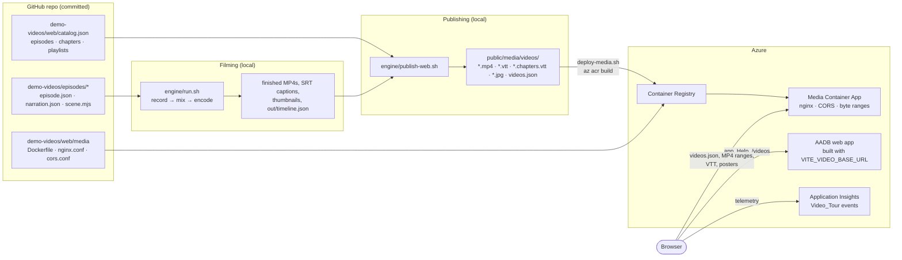
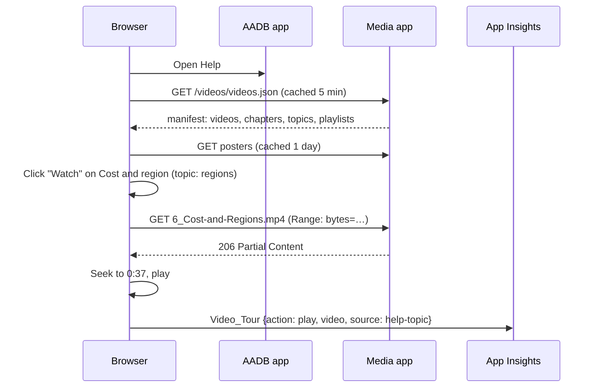

# Video Tour: How It Works

The Azure Architecture Diagram Builder (AADB) ships a narrated video series (a trailer and Episodes 1–11) inside the app. People find it where they look for help:

- **Help → Video Tour:** all episodes, with playlists, chapters, "Up next" and a copy-link button.
- **Help → Start Here:** opens with the trailer.
- **Watch chips:** on the start paths and feature cards, each opens the right episode at the right moment.
- **`/videos`:** a shareable page that needs no sign-in, deep-linkable to any second of any episode.

This guide explains the whole system: how the videos become web media, where they are hosted, how the app finds and plays them, how chapters and Watch links are wired, what telemetry is sent, and how to operate it. How the videos themselves are filmed is covered in [Demo Video Production](DEMO-VIDEO-PRODUCTION.md).

## Contents

1. [The design in one paragraph](#the-design-in-one-paragraph)
2. [Architecture](#architecture)
3. [The pieces](#the-pieces)
4. [The catalog](#the-catalog-demo-videoswebcatalogjson)
5. [Publishing](#publishing-publish-websh)
6. [The manifest](#the-manifest-videosjson)
7. [Hosting](#hosting-the-media-container-app)
8. [The app](#the-app)
9. [Telemetry](#telemetry)
10. [Runbooks](#runbooks)
11. [Troubleshooting](#troubleshooting)
12. [Design decisions](#design-decisions)
13. [Files](#files)

## The design in one paragraph

The videos are **data, not code**. A committed catalog (`demo-videos/web/catalog.json`) describes the episodes and their chapters. Chapters point at narration lines, not timestamps. A publish script turns the finished MP4s into web media and writes a runtime manifest (`videos.json`), resolving each chapter to the exact second its narration line starts in the final cut. A small nginx Container App serves those files. The app reads the manifest when Help opens, so re-filming an episode needs a re-publish, not an app release.

## Architecture



At runtime the browser talks to two origins: the AADB app (the UI) and the media app (the files). The AADB server never proxies media.



## The pieces

| Piece | Where | What it does |
| --- | --- | --- |
| Catalog | `demo-videos/web/catalog.json` | Which episodes are in the tour, their summaries, playlists, and chapters (anchored on narration lines, optionally with a deep-link `key`) |
| Film engine | `demo-videos/engine/film.mjs` | Records each take; stamps `filmed` (date) and `appVersion` (from `/version.json`) into `out/timeline.json` |
| Publisher | `demo-videos/engine/publish-web.sh` → `publish-web.py` | Streaming encodes, WebVTT captions and chapters, posters, and `videos.json` |
| Media host | `demo-videos/web/media/` + `deploy-media.sh` | nginx image with the published files; built in ACR, run as a Container App |
| Manifest loader | `src/services/videoTour.ts` | Base URL, manifest fetch and validation, formatting, deep-link URLs |
| Player and gallery | `src/components/VideoTour.tsx` (+ `.css`) | Gallery, playlists, player, chapters, Up next, copy link, telemetry |
| Help integration | `src/components/GuidedHelpPanel.tsx` | Video Tour section, trailer card, Watch chips |
| Shareable page | `src/components/VideoTourPage.tsx`, `src/main.tsx` | `/videos?v=<id>&t=<seconds>`, rendered without the editor |
| Telemetry | `src/services/telemetryService.ts` | `trackVideoTour()`; media host excluded from correlation headers |
| Tests | `scripts/test-video-tour.ts` (`npm run test:video-tour`) | Formatting, manifest validation, and that every Watch key exists in the catalog |

## The catalog (`demo-videos/web/catalog.json`)

The catalog is the only file you edit to change what the tour shows.

```json
{
  "title": "AADB video tour",
  "playlists": [
    { "id": "start", "label": "Get started", "episodes": ["00-trailer", "01-prompt-to-architecture"] }
  ],
  "episodes": [
    {
      "dir": "06-cost-and-regions",
      "filmed": "2026-10-22",
      "appVersion": "2.1.12",
      "summary": "Price badges, fourteen regions, production sizing, cost exports and hiding prices for customer demos.",
      "chapters": [
        { "narr": "n05-regions", "title": "Compare regions", "key": "regions" },
        { "narr": ["n12-terminal", "n12-build-only"], "title": "Build it on a laptop" }
      ]
    }
  ]
}
```

| Field | Meaning |
| --- | --- |
| `episodes[].dir` | Folder under `demo-videos/episodes/`. Title, badge, output file name and `internal` come from that folder's `episode.json`. |
| `filmed`, `appVersion` | Optional overrides. When absent, the publisher uses what `film.mjs` stamped into the take's `timeline.json`. |
| `summary` | One line shown on the card and in the player. |
| `chapters[].narr` | The narration cue the chapter starts on (an id from `narration.json`), or a list when a scene picks one of several lines depending on the take. |
| `chapters[].title` | Chapter label in the player and the WebVTT chapters track. |
| `chapters[].key` | Optional deep-link id. Help's Watch chips refer to these keys. Keys must be unique across the catalog. |
| `playlists[]` | Named filters over the episode list, shown as tabs in the gallery. |

**Why chapters point at narration lines.** A take's timing changes whenever an episode is re-filmed: model latency differs, waits are sped up by different amounts, and scenes add or skip lines. A narration line is the one stable anchor, because the narration describes the moment the chapter is about. The publisher looks up where that line lands in the final cut, so chapters and Watch links stay correct after every re-film without anyone editing a timestamp.

## Publishing (`publish-web.sh`)

```bash
cd demo-videos
engine/publish-web.sh                     # writes ../public/media/videos (git-ignored)
engine/publish-web.sh --dest /tmp/tour    # or any folder
```

It reads the finished files from `$OUTPUT_DIR` (set in `demo-videos/.env`, default `demo-videos/videos/`): `<output>.mp4`, `captions/<output>.srt` and `thumbnails/<output>.jpg`, plus each episode's `out/timeline.json`. For every catalog episode it:

1. **Skips internal episodes.** If `episode.json` has `"internal": true`, nothing is published.
2. **Encodes for streaming.** H.264 1080p at CRF 26 (max 3.5 Mbit/s), AAC 128 kbit/s, `-movflags +faststart`, so playback starts before the download finishes and seeking uses byte ranges. That's about 18 MB per episode, roughly a third of the master. An encode is reused when it is newer than its master.
3. **Converts captions.** SRT becomes `<output>.vtt`.
4. **Times the chapters.** It replays the cut list that `mix.py` applied, so a cue's recording time maps to its final time, then writes `<output>.chapters.vtt`. Each chapter starts 0.4 s before its line, and an "Introduction" chapter is added when the first one starts after 3 s. A chapter whose cue is missing from the take is skipped with a warning.
5. **Makes a poster.** The episode thumbnail, 960 px wide.
6. **Writes `videos.json`.** Episodes in catalog order, plus the topic map and playlists (playlists drop any episode that wasn't published).

`--upload <storage-account>` copies the folder to a public-read Blob Storage container instead, for tenants where that is allowed. See [Design decisions](#design-decisions).

## The manifest (`videos.json`)

Generated, never edited by hand. The app validates its shape and treats anything else as "tour unavailable".

```json
{
  "version": 1,
  "title": "AADB video tour",
  "generatedAt": "2026-10-23T23:44:10+00:00",
  "videos": [
    {
      "id": "06-cost-and-regions",
      "badge": "Episode 6",
      "title": "Cost and Regions",
      "summary": "Price badges, fourteen regions, …",
      "duration": 148.27,
      "filmed": "2026-10-22",
      "appVersion": null,
      "src": "6_Cost-and-Regions.mp4",
      "captions": "6_Cost-and-Regions.vtt",
      "poster": "6_Cost-and-Regions.jpg",
      "chapters": [
        { "title": "Introduction", "at": 0 },
        { "title": "Compare regions", "at": 37.49, "key": "regions" }
      ]
    }
  ],
  "topics": {
    "regions": { "video": "06-cost-and-regions", "at": 37.49, "title": "Compare regions" }
  },
  "playlists": [{ "id": "start", "label": "Get started", "episodes": ["00-trailer", "01-prompt-to-architecture"] }]
}
```

File names in the manifest are relative to the base URL. Absolute URLs are also accepted, if media ever moves to a CDN.

## Hosting: the media Container App

`demo-videos/web/media/` holds a three-file nginx image:

- **`Dockerfile`:** `nginx:alpine`, plus the published files under `/usr/share/nginx/html/videos/`.
- **`nginx.conf`:**
  - serves only `GET`/`HEAD`/`OPTIONS` under `/videos/` and returns 404 everywhere else;
  - serves byte ranges (`206 Partial Content`) natively;
  - sets correct types for `.mp4`, `.vtt`, `.jpg` and `.json`;
  - caches media for a day and `videos.json` for five minutes;
  - answers `/healthz`.
- **`cors.conf`:** included in every location, because nginx drops server-level `add_header` directives in any location that sets its own.
  - `Access-Control-Allow-Origin: *`: the media is public, and the player loads video and caption tracks with `crossorigin="anonymous"`.
  - Allows the `Range` header, plus the tracing headers telemetry SDKs add (`Request-Id`, `Request-Context`, `traceparent`, `tracestate`).
  - Exposes `Content-Range`, and caches preflights for a day.

Deploy or update it:

```bash
demo-videos/web/media/deploy-media.sh <acr-name> <container-app> <resource-group> [<container-apps-environment>]
```

The script:
1. Stages the published folder with the three files.
2. Builds the image in ACR, tagged `<UTC timestamp>-<manifest hash>`.
3. Updates the Container App, or creates it when you pass the environment: external ingress on port 80, single-revision mode, 0.25 vCPU / 0.5 GiB, scaling 0–3 replicas, and ACR pull through the app's system-assigned managed identity.
4. Waits for `/healthz`, checks that `videos.json` is served, and prints the `VITE_VIDEO_BASE_URL` to build AADB with.

The app is created in single-revision mode, so each media update replaces the previous one (for an existing app: `az containerapp revision set-mode --mode single`).

**Cost.** With scale-to-zero, the app costs nothing while idle. A cold start adds a second or two to the first manifest request. The whole tour is about 225 MB, and a full view of one episode is about 18 MB of egress.

## The app

### Base URL

`src/services/videoTour.ts` reads `VITE_VIDEO_BASE_URL` at build time. When it is unset (local development), it uses `/media/videos`, which Vite serves from `public/media/videos`. Production sets it in the target's env file, and `scripts/production/deploy-webapp.sh` passes every `VITE_*` value to the Docker build (`Dockerfile`: `ARG`/`ENV VITE_VIDEO_BASE_URL`). `public/media/` is git-ignored and excluded in `.dockerignore`, so local media never lands in a commit or an image.

### Loading the manifest

`useVideoManifest()` fetches `videos.json` once per page load, but only when Help opens, so the editor never pays for it. The hook returns `undefined` while loading and `null` when the tour is unavailable. On failure the cached promise is cleared, so the next Help open retries. When the tour is unavailable, Help still works: the trailer card and Watch chips are simply not rendered, and the Video Tour section says the tour isn't available right now.

### Help integration (`GuidedHelpPanel.tsx`)

- **Video Tour section:** the second navigation item. It renders `<VideoTour>` with the already-loaded manifest.
- **Trailer card:** at the top of Start Here, when the manifest contains `00-trailer`.
- **Watch chips:** paths and feature cards carry a `video` field (a catalog `key`, for example `video: 'regions'`). `WatchLink` renders a chip only when that key exists in `manifest.topics`. Clicking it opens the Video Tour section at the episode and the chapter's second. `npm run test:video-tour` fails if Help refers to a key the catalog doesn't define.

To add a Watch chip, give the chapter a `key` in the catalog, re-publish, and add `video: '<key>'` to the feature in `GuidedHelpPanel.tsx`.

### The player (`VideoTour.tsx`)

- **Gallery:** cards with poster, duration, badge, title and summary, plus playlist tabs.
- **Player:** a native `<video controls preload="metadata" crossorigin="anonymous" playsinline>`.
  - When a start time is given (a Watch chip or `?t=`), it seeks after metadata loads, then tries to play.
  - Browsers may block unmuted autoplay on page load; the controls stay available.
- **Captions:** the subtitles are burned into the picture, so the WebVTT captions track is attached but off by default. It's there for screen readers and for viewers who want larger text.
- **Chapters:** a side list, built from the manifest, that highlights the current chapter and seeks on click.
- **Metadata:** "Filmed Oct 22, 2026 on v2.1.12" (the version is shown when known), so viewers can tell when the UI may have changed since filming.
- **Up next** follows catalog order. **Copy link** copies `/videos?v=<id>&t=<current second>`.

### The `/videos` page

`src/main.tsx` renders `VideoTourPage` instead of the editor when the path is `/videos` (with or without a trailing slash). It reads `?v=<episode id>&t=<seconds>`. nginx's SPA fallback (`try_files … /index.html`) and Vite's dev server both serve `index.html` for that path, so no server change was needed.

## Telemetry

Event `Video_Tour` (customEvents), sent by `trackVideoTour()`:

| Property | Values |
| --- | --- |
| `action` | `open` (tour shown), `play` (first play of a video), `progress` (25 %, 50 %, 75 %), `complete`, `chapter` (chapter clicked), `share` (link copied) |
| `source` | `help` (Video Tour section), `help-topic` (a Watch chip), `start-here` (trailer card), `page` (`/videos`) |
| `video` | Episode id, for example `06-cost-and-regions` |
| `chapter` | Chapter title, for `chapter` events |

Measurements: `position` (seconds), `duration` (seconds), and `completion` (0–1).

The media host is listed in `correlationHeaderExcludedDomains`, so media requests carry no `Request-Id`/`traceparent`. Watching a video sends no personal data beyond the standard telemetry context.

Useful queries:

```kusto
// Plays and completions per episode, last 30 days
customEvents
| where timestamp > ago(30d) and name == "Video_Tour"
| extend action = tostring(customDimensions.action), video = tostring(customDimensions.video)
| where action in ("play", "complete")
| summarize plays = countif(action == "play"), completes = countif(action == "complete") by video
| extend completionRate = round(100.0 * completes / plays, 1)
| order by plays desc

// Where viewers start: Help section, Watch chips, trailer card, or the shareable page
customEvents
| where timestamp > ago(30d) and name == "Video_Tour" and tostring(customDimensions.action) == "play"
| summarize plays = count() by source = tostring(customDimensions.source)

// Which Watch chips are used
customEvents
| where timestamp > ago(30d) and name == "Help_Opened" and tostring(customDimensions.section) startswith "video-"
| summarize clicks = count() by topic = substring(tostring(customDimensions.section), 6)
| order by clicks desc
```

## Runbooks

### Run it locally

```bash
cd demo-videos && engine/publish-web.sh && cd ..   # once, or after re-filming
npm run dev                                         # Help → Video Tour, or http://localhost:3000/videos
```

To test against a hosted media app or a local container, set the base URL for the dev server:

```bash
VITE_VIDEO_BASE_URL=https://<media-app-host>/videos npm run dev
```

The cross-origin path is what production uses. Test it at least once with telemetry enabled (see [Troubleshooting](#troubleshooting)).

### Re-film an episode

```bash
cd demo-videos
engine/run.sh episodes/06-cost-and-regions                                  # new take
engine/publish-web.sh                                                       # re-encode, re-time chapters, new manifest
web/media/deploy-media.sh <acr> <media-app> <resource-group>                # roll out
```

No AADB release is needed. Browsers pick up the new manifest within five minutes. Media files keep their names, so a viewer may see the old cut for up to a day from cache. Rename the output, or wait, if that matters.

### Add a new episode

1. Film it (see [Demo Video Production](DEMO-VIDEO-PRODUCTION.md)).
2. Add it to `catalog.json`: `dir`, `summary`, `chapters` (with `key`s for anything Help should link to), and playlists.
3. Optionally, add `video: '<key>'` to the matching Help features.
4. Run `npm run test:video-tour`, then publish and deploy the media. An app release is needed only when you changed `GuidedHelpPanel.tsx`.

### Keep an episode out of the tour

Set `"internal": true` in its `episode.json`. The publisher skips it, so it is never in the manifest or the image. Episodes that aren't in the catalog are not published either.

### Change where the media lives

Publish to the new host, set `VITE_VIDEO_BASE_URL` in the target's env file, and release AADB. The new host must serve byte ranges and the CORS headers in `cors.conf`.

### Roll back

- **Media:** `az containerapp update -n <media-app> -g <rg> --image <acr>.azurecr.io/<media-app>:<previous tag>`.
- **App:** use the rollback command that `deploy-webapp.sh` prints. The previous revision stays active at 0 % traffic.

## Troubleshooting

| Symptom | Cause and fix |
| --- | --- |
| Help shows no trailer card and no Watch chips; Video Tour says the tour isn't available | The manifest didn't load. Open the browser console. A CORS error naming `request-id` or `traceparent` means the media host doesn't allow tracing headers in preflight: deploy the current `cors.conf`. This only appears where Application Insights is configured, which is why it can pass locally and fail in production. A 404 means the base URL is wrong or nothing was published. |
| Video plays locally but not in production | The media host must send `Access-Control-Allow-Origin` on the MP4 and VTT responses too, because the player uses `crossorigin="anonymous"`. Check with `curl -I -H "Origin: https://example" <base>/videos/<file>.mp4`. |
| Seeking restarts the download, or a chapter click waits a long time | The host isn't serving byte ranges, or the file lacks `+faststart`. `curl -H "Range: bytes=0-9" -I <url>` must return `206`. Re-publish to re-encode. |
| Subtitles appear twice | The captions track was turned on. It's off by default because the subtitles are burned in. |
| A chapter is missing after re-filming | Its narration cue wasn't used in that take; the publisher logs `chapter '…' has no cue`. Point the chapter at the cue the take used, or at a list of alternatives. |
| A deep link opens at the start, paused | Expected when a browser blocks autoplay on page load; the player still seeks to `t`. Press play. |
| First request after a quiet period is slow | The media app scaled to zero. Set `--min-replicas 1` if that matters (about the cost of one small replica). |
| Blob Storage upload fails, or public access settings revert | Some tenants enforce a policy that disables public network access and anonymous blob reads on storage accounts, and silently rewrites updates. Use the media Container App. |

## Design decisions

- **Runtime manifest instead of bundling metadata.** The tour changes more often than the app. Reading `videos.json` at runtime lets a re-filmed episode go live without a release, and adds only a few kilobytes of code to the app (nothing is fetched until Help opens).
- **Chapters anchored on narration lines.** Timestamps break on every re-film; narration lines don't. See [The catalog](#the-catalog-demo-videoswebcatalogjson).
- **A separate media origin, not the app image.** Baking ~225 MB into the AADB image would slow every deploy, and re-filming would need an app release. A dedicated nginx app keeps media and app lifecycles independent and costs nothing while idle.
- **A Container App rather than Blob Storage.** Blob Storage with anonymous read is the textbook choice, and `publish-web.sh --upload` supports it. Our tenant's policy forces storage accounts to disable public network access and anonymous reads, which makes a public container impossible. The alternative was a private endpoint with the app proxying media; that means more infrastructure and app code, and uploads that have to run from inside the VNet. nginx gives byte ranges, CORS and caching with three small files.
- **No Azure Media Services, no HLS.** Media Services is retired, and short 1080p clips stream well as progressive MP4 with `+faststart` and byte ranges.
- **Native `<video>` element.** It gives accessible controls, keyboard support, picture-in-picture and caption menus, with no player dependency.
- **Internal content can't leak by accident.** The `internal` flag is enforced by the publisher, so internal episodes never reach the manifest or the image, whatever the catalog says.

## Files

```text
demo-videos/
├── web/
│   ├── catalog.json            # what the tour shows (edit this)
│   └── media/
│       ├── Dockerfile          # nginx image with the published files
│       ├── nginx.conf          # ranges, types, caching, GET/HEAD only
│       ├── cors.conf           # CORS headers, included in every location
│       └── deploy-media.sh     # build in ACR, create/update the Container App
└── engine/
    ├── publish-web.sh          # wrapper (reads demo-videos/.env)
    ├── publish-web.py          # encodes, captions, chapters, posters, videos.json
    └── film.mjs                # stamps filmed date and app version into each take
src/
├── services/videoTour.ts       # base URL, manifest loader, formatting, deep links
├── services/telemetryService.ts# trackVideoTour(), correlation-header exclusion
├── components/VideoTour.tsx    # gallery and player
├── components/VideoTour.css
├── components/VideoTourPage.tsx# /videos page
├── components/GuidedHelpPanel.tsx  # Video Tour section, trailer card, Watch chips
└── main.tsx                    # routes /videos to the page
scripts/test-video-tour.ts      # npm run test:video-tour (part of test:deterministic)
public/media/videos/            # local publish output (git-ignored, not in the image)
```
